<div align="center">

# 🛡️ OmniGuard AML
### Dual-Pipeline Financial-Crime Compliance & Adversarial Stress-Testing Platform

*Bridging Upstream Control Stress-Testing with Downstream Citation-Grounded Autonomous Investigation*

[](#-measured-results)
[](#-quickstart-local-no-docker)
[](#-system-architecture)
[](#-models--inference)
[](#-system-architecture)
[](#-measured-results)
[](#)

[Overview](#-overview) • [Key Features](#-key-features) • [Architecture](#-system-architecture) • [Measured Benchmarks](#-measured-results) • [Quickstart](#-quickstart-local-no-docker) • [Web Interface](#-web-interface) • [Security & Compliance Invariants](#-strict-refusals--compliance-invariants)

</div>

---

## 🌟 Overview

Traditional Anti-Money Laundering (AML) monitoring systems suffer from **95%+ false-positive alert rates**, brittle rules, and operational lag. When generative AI is added naively, it introduces hallucinated citations, prompt-injection vulnerabilities, and untrusted autonomous actions.

**OmniGuard AML** solves this with a **Dual-Pipeline Architecture**:
1. **Upstream ScenarioLab**: Proactive, synthetic control stress-testing. Compliance concerns are translated into synthetic transaction batches with **SHA-256 tamper-evident expected outcomes** before being executed against monitoring controls to expose coverage gaps.
2. **Downstream Investigation Engine**: Autonomous alert triage combining **hybrid ML scoring** (LightGBM + Isolation Forest + NetworkX graph analytics) with an **adversarial dual-chain LLM workflow** (NVIDIA NIM Nemotron-3 Super-120B & Nemotron-3.5 Lightning-30B). Every fact is validated against a deterministic citation verifier, and decisions are locked behind a mandatory human gate.

> Built and empirically benchmarked per `omniguard_product_plan.md` — see [FLOW.md](FLOW.md) for execution traces and [DECISIONS.md](DECISIONS.md) for architectural trade-off logs.

---

## ⚡ Key Features

| Capability | What OmniGuard Delivers |
|---|---|
| **Adversarial Dual-Chain Reasoning** | Dual LLM investigation: an **Investigator** builds the case while a parallel **Challenger** tests exculpatory evidence. A deterministic adjudicator reconciles differences without LLM judge bias. |
| **Deterministic Citation Verification** | Every cited transaction ID, amount, and policy revision is cross-checked against database truth. Hallucinations or mismatches trigger immediate human review. |
| **Prompt Injection Sandboxing** | Multi-heuristic transaction memo scanning with XML sandboxing. Quarantined payloads are isolated and automatically routed to human escalation. |
| **Tamper-Evident ScenarioLab** | Synthetic test batches seal expected outcomes using SHA-256 hashes *before* control execution, preventing retroactive threshold calibration or audit tampering. |
| **Hybrid ML & Graph Analytics** | Combines supervised tabular scoring (LightGBM / HistGB), unsupervised anomaly detection (Isolation Forest), and 1-hop NetworkX counterparty graph metrics. |
| **Explainable Predictions (SHAP)** | TreeExplainer feature attributions for every alert, showing exact tabular and behavioral drivers behind elevated risk scores. |
| **Resilient LLM Inference** | Intelligent multi-tier fallback: `Nemotron-3-Super-120B` → `Nemotron-3.5-Lightning-30B` on queue congestion or timeout → deterministic offline mock for CI/CD. |
| **Mandatory Human-in-the-Loop** | Fraud alerts are never self-closed. Human compliance analysts retain final signoff with watermark-checked concurrency protection. |

---

## 📐 System Architecture

### 1. Dual-Pipeline Flow

```mermaid
flowchart TD
    subgraph Downstream ["🔍 Downstream Investigation Engine"]
        A1[Incoming Alert / Transaction Stream] --> A2[Feature & Graph Engine<br/>NetworkX + Tabular Features]
        A2 --> A3[Hybrid ML Scoring<br/>LightGBM + Isolation Forest + SHAP]
        A3 --> A4[Policy Retrieval<br/>pgvector / Semantic Tag Match]
        A4 --> A5{Parallel LLM Pass}
        A5 -->|Primary Agent| A6[NVIDIA Nemotron-3 Super-120B<br/>Investigator]
        A5 -->|Adversarial Agent| A7[NVIDIA Nemotron-3.5 Lightning-30B<br/>Challenger]
        A6 & A7 --> A8[Deterministic Verifier<br/>Citation & Math Check]
        A8 --> A9[Audit Trail & Evidence Pack<br/>PostgreSQL / Hash Seal]
        A9 --> A10[🛑 Mandatory Human Review Gate]
        A10 --> A11[Finalized Regulatory Disposition]
    end

    subgraph Upstream ["🔬 Upstream ScenarioLab (Control Stress-Testing)"]
        S1[Compliance Risk Concern] --> S2[LLM Authoring<br/>Pydantic Test Specifications]
        S2 --> S3[Code Generation Engine<br/>Deterministic Transaction Batch]
        S3 --> S4[🔏 Lock Expectations<br/>SHA-256 Hash Seal]
        S4 --> S5[Adversarial Challenger<br/>Rubric & Leakage Review]
        S5 --> S6[Compliance Officer Signoff]
        S6 --> S7[Execute Control<br/>e.g. 48h Passthrough]
        S7 --> S8[Coverage Gap & Diff Report<br/>Match / Miss / Over-Alert]
    end
```



---

## 🛡️ Strict Refusals & Compliance Invariants

OmniGuard enforces non-negotiable architectural guardrails designed for financial regulatory scrutiny:

- 🚫 **No Autonomous Auto-Close**: Fraud, high-risk, and injection-flagged alerts can **never** be auto-closed by an agent. The human compliance gate always fires.
- 🧮 **No LLM Math**: LLMs reason strictly over precomputed numbers and graph features. LLM hallucinated calculations are mathematically prohibited.
- 💉 **Prompt Injection Quarantine**: Free-text payment memos are scanned for prompt-injection markers and wrapped in XML sandboxes. Quarantined memos force `CONFLICT_HUMAN_REVIEW` with raw payloads preserved intact.
- 📚 **100% Citation Enforcement**: The verifier verifies transaction IDs and active policy timestamp validity. Citations that fail verification force human triage.
- 🔏 **Pre-Execution SHA-256 Locking**: Expected scenario outcomes are cryptographically locked prior to control execution to eliminate retroactive outcome tampering.
- 🛡️ **No Transaction Vector Search**: SQL queries use strict parameterized execution; vector similarity (`pgvector`) is strictly restricted to policy manuals and static regulatory scenarios.

---

## 📊 Measured Results

### 1. Held-Out ML Evaluation (Group Split by Account — Zero Leakage)

Evaluated across PaySim and IBM AML synthetic benchmark ledgers with strict group splits to prevent counterparty contamination:

| Dataset | Split & Size | Model | Features | Precision | Recall | F1 Score |
|---|---|---|---|:---:|:---:|:---:|
| **PaySim** | n=338 account windows | **LightGBM (Shipped Argmax)** | Flat + Graph | **0.643** | **0.474** | **0.545** |
| **PaySim** | n=338 account windows | LightGBM | Flat only | 0.600 | 0.474 | 0.529 |
| **PaySim** | n=338 account windows | HistGB | Flat + Graph | 0.500 | 0.421 | 0.457 |
| **PaySim** | n=338 account windows | HistGB | Flat only | 0.600 | 0.474 | 0.529 |
| **IBM HI-Small** | n=4,982 windows | LightGBM | Flat + Graph | 0.630 | 0.408 | 0.495 |
| **IBM HI-Small** | n=4,982 windows | LightGBM | Flat only | 0.683 | 0.344 | 0.457 |
| **IBM HI-Small** | n=4,982 windows | **HistGB (Held-out Argmax)** | Flat + Graph | **0.619** | **0.416** | **0.498** |
| **IBM HI-Small** | n=4,982 windows | HistGB | Flat only | 0.627 | 0.336 | 0.438 |

*Note: Shipped `models/` maintains the PaySim held-out argmax (see `models/meta.json` + MLflow). IBM runs were maintained in an isolated experiment database (`omniguard_ibm`).*

### 2. 50 Distinct Case Matrix (Postgres, PaySim + Synthetic, Mock LLM)

| Category | n | Auto-Escalate | Auto-Close | Human Review Conflict | Citation Accuracy | Injection Quarantine |
|---|:---:|:---:|:---:|:---:|:---:|:---:|
| **True Positive (TP)** | 15 | 4 | 0 | 11 | **1.000** | — |
| **True Negative (TN)** | 10 | 0 | 8 | 2 | **1.000** | — |
| **Lookalike Fraud** | 10 | 0 | 6 | 4 | **1.000** | 0.100 |
| **Boundary Cases** | 10 | 0 | 7 | 3 | **1.000** | — |
| **Prompt Injection Attack** | 5 | 0 | 0 | 5 | **1.000** | **1.000** |

*Takeaway: 0 out of 15 true positives were auto-closed. All injection attempts were successfully quarantined and diverted to human compliance officers. Citations are checked, and failures go to a human.*

### 3. Live NVIDIA NIM Smoke Test (Super-120B + Lightning-30B, n=6)

- **Citation Accuracy**: 0.667 (2 instances of model citing policy title instead of strict ID were flagged and safely routed to human review).
- **Prompt Injection Defense**: 1/1 captured and quarantined.
- **Token Efficiency**: Dual agent consumed ~12.7k tokens vs ~9.9k tokens for single agent.
- **Failover Verification**: Congested Super-120B requests safely downgraded to Lightning-30B with `fallback: true` logged in audit table.

### 4. End-to-End Pipeline Benchmarks (`HI-Small` Dataset)

| Pipeline Stage | Details / Scope | Wall Time |
| :--- | :--- | :--- |
| **1. Data Acquisition** | Kaggle download of IBM AML `HI-Small` dataset (454 MiB) | `~65s` |
| **2. DB Ingestion** | Bulk load of 53,785 transactions into isolated `omniguard_ibm` PostgreSQL DB | `~128s` |
| **3. Model Training** | CPU-bound model fitting & MLflow tracking across ~5,000 sliding windows | *Variable (CPU-bound)* |
| **4. Verification & CI** | Byte-verification/restore of `models/`, docs update, Git commit, and 37-test `pytest` suite | `~36s` |

### ⚠️ The Honest Engineering Caveat
> **Read Before Quoting:** Evaluated on realistic synthetic ledgers (338 windows for PaySim, 4,982 windows for IBM HI-Small) and free-tier NVIDIA NIM endpoints. The pipeline logic is strictly verified (fraud never auto-clears, citations enforced, injection quarantined). Shipped models represent prototype compliance pipelines rather than a calibrated enterprise-scale deployment.

---

## 🧰 Technology Stack

```
┌─────────────────────────────────────────────────────────────┐
│                       Web Frontend                          │
│               React 18 • Vite • Lucide Icons                │
└──────────────────────────────┬──────────────────────────────┘
                               │ HTTP / JSON API
┌──────────────────────────────▼──────────────────────────────┐
│                    FastAPI Backend Server                   │
│          Pydantic v2 • Starlette • Background Tasks         │
├──────────────────────────────┬──────────────────────────────┤
│       Machine Learning       │      Agent & LLM Engine      │
│  • LightGBM & HistGB         │  • NVIDIA NIM (Nemotron 120B)│
│  • Isolation Forest (sklearn)│  • Nemotron 30B (Fallback)   │
│  • NetworkX Graph Engine     │  • Deterministic Verifier    │
│  • SHAP TreeExplainer        │  • LangGraph / Dual Chain    │
├──────────────────────────────┴──────────────────────────────┤
│                   Data & Persistence Layer                  │
│   • PostgreSQL 16 + pgvector (or SQLite zero-config local)   │
│   • Redis 7 + ARQ Task Worker                               │
│   • MLflow Experiment Tracking                              │
└─────────────────────────────────────────────────────────────┘
```

---

## 🚀 Quickstart (Local, No Docker)

Get OmniGuard running locally in less than 2 minutes using built-in SQLite and deterministic mock models:

### 1. Clone & Set Up Environment

```powershell
# Clone the repository
git clone https://github.com/akcodes-py/omniguard-aml.git
cd omniguard-aml

# Create and activate virtual environment
python -m venv .venv
.\.venv\Scripts\Activate.ps1   # On Linux/macOS: source .venv/bin/activate

# Install Python dependencies
pip install -r requirements.txt
```

### 2. Initialize Database & Seed Baseline Data

```powershell
# Seed database with synthetic accounts, alerts, and policies
python scripts/seed.py --reset

# Train ML baseline (LightGBM + IsolationForest)
python scripts/train.py

# Run test suite (37 unit, e2e, and resilience tests)
python -m pytest -q
```

### 3. Launch Backend API

```powershell
$env:PYTHONPATH='src'
uvicorn omniguard.api:app --reload --port 8000
```
> API will be available at [http://localhost:8000](http://localhost:8000) with interactive Swagger documentation at [http://localhost:8000/docs](http://localhost:8000/docs).

---

## 🐳 Docker Deployment (Full Production Stack)

Run the complete multi-service stack with PostgreSQL + pgvector, Redis, and MLflow:

```bash
# 1. Start core data infrastructure
docker compose up -d postgres redis

# 2. Configure environment variables
cp .env.example .env
# Edit .env and supply your POSTGRES_PASSWORD, API_KEY, and optional NIM_API_KEY

# 3. Seed PostgreSQL database
python scripts/seed.py --reset

# 4. (Optional) Launch MLflow tracking server
docker compose --profile full up -d mlflow
```

Services exposed:
- **FastAPI Core**: `http://localhost:8000`
- **PostgreSQL + pgvector**: `localhost:5433`
- **Redis Queue**: `localhost:6379`
- **MLflow Tracking**: `http://localhost:5001`

---

## 💻 Web Interface

The OmniGuard Web Console provides an intuitive analyst dashboard:

```powershell
cd ui
npm install
npm run dev
```
Open **[http://localhost:5173](http://localhost:5173)** in your browser.

- 🔑 **API Key & System Health**: Status badge — amber until the key is verified, green when connected — opens a key drawer that performs a real authenticated check (`GET /auth/check`) and shows live service status (queue backend and inference provider, `nim` or `mock`). The key is held in memory only, never persisted.
- 🚨 **Alert Investigation Studio** (dispatch left, evidence ledger right):
  - One-click presets from the seeded eval/demo alert set (`eval3-tp-00`, `eval3-inj-00`, `eval3-lik-00`, `alert-demo-rapid`).
  - Live 1.5s status polling until the disposition lands; ledger rows carry the composite ML score, disposition, citation-verifier count, and token cost.
  - Analyst signoff form (decision + notes) wired to the concurrency-protected review endpoint, with per-run raw evidence. Session record counts and last API-call latency show in each ledger footer.
- 🧪 **ScenarioLab Workbench**:
  - Submit plain-English compliance concerns (e.g. *"Smurfing via micro-deposits under $10,000 threshold"*).
  - Review adversarial challenger findings, then approve the SHA-256-locked scenario set to execute the control.
  - Inspect match / miss / over-alert results, the coverage-gap report ("What was NOT tested"), and the evidence-pack hash.

---

## 📂 Project Directory Structure

```
omniguard-aml/
├── db/                       # Canonical SQL schemas (PostgreSQL & SQLite)
│   ├── schema_canonical.sql
│   └── schema_sqlite.sql
├── models/                   # Serialized ML artifacts & metadata
│   ├── supervised.pkl        # LightGBM binary classifier
│   ├── isoforest.pkl         # Isolation Forest anomaly model
│   └── meta.json             # Feature names, metrics, and thresholds
├── scripts/                  # Operational CLI entry points
│   ├── seed.py               # Database seeder (PaySim + synthetic accounts)
│   ├── train.py              # Model training & group-split evaluation
│   ├── load_ibm.py           # Kaggle IBM HI-Small AML dataset loader
│   ├── eval50_v2.py          # 50-case benchmark evaluation script
│   └── smoke_nim.py          # Live NVIDIA NIM connectivity smoke test
├── src/omniguard/            # Core application package
│   ├── api.py                # FastAPI endpoints & security middleware
│   ├── config.py             # Pydantic BaseSettings & configuration
│   ├── db.py                 # Multi-dialect database abstraction layer
│   ├── features.py           # Deterministic transactional feature engineering
│   ├── graph_features.py     # NetworkX counterparty graph metrics
│   ├── ml.py                 # Scorer, feature vectorizer, & SHAP explainers
│   ├── injection.py          # Memo security scanner & XML sandboxing
│   ├── policy_retrieval.py   # pgvector / semantic policy retrieval
│   ├── llm.py                # NIM / Bedrock / Mock dual-chain orchestration
│   ├── verifier.py           # Deterministic citation & numeric verifier
│   ├── scenario_gen.py       # ScenarioLab synthetic generator & SHA-256 locker
│   ├── graphs_investigation.py # Alert investigation workflow graph
│   ├── graphs_scenario.py    # ScenarioLab control stress-test graph
│   └── worker.py             # Asynchronous Redis/ARQ job worker
├── tests/                    # Pytest test suite (37 unit & e2e tests)
├── ui/                       # React / Vite single-page application
├── docker-compose.yml        # Multi-container orchestration specification
├── FLOW.md                   # Complete architectural call-graph documentation
├── DECISIONS.md              # Architectural decision records (ADRs)
└── DEMO.md                   # 10-minute recorded walkthrough script
```

---

## 🗺️ What's Next (v2 Roadmap)

- [ ] **Streaming Ingestion**: Real-time event streaming via Apache Kafka / Flink for continuous sub-second window aggregation.
- [ ] **Graph Neural Networks (GNN)**: Persistent Neo4j integration with PyG/DGL graph neural networks to catch multi-hop layering and complex money-muling rings.
- [ ] **Adverse Media & OSINT**: Live web and sanction screening integrations for automated customer intelligence.
- [ ] **Regulatory SAR Automation**: Automatic FinCEN XML Suspicious Activity Report (SAR) narrative and package generation.
- [ ] **Multi-Tenant RBAC**: Enterprise tenant isolation with cryptographic partition keys and role-based audit access.

---

## 📜 License & Credits

- Licensed under the **MIT License**.
- Built with [FastAPI](https://fastapi.tiangolo.com/), [NVIDIA NIM](https://developer.nvidia.com/nim), [LightGBM](https://lightgbm.readthedocs.io/), [SHAP](https://shap.readthedocs.io/), and [PostgreSQL](https://www.postgresql.org/).
